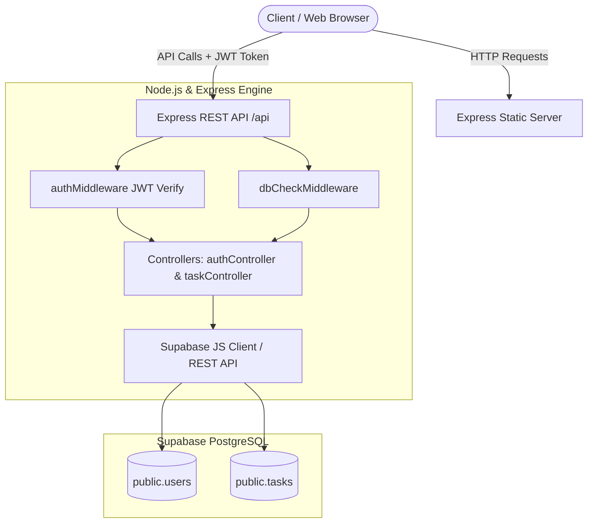
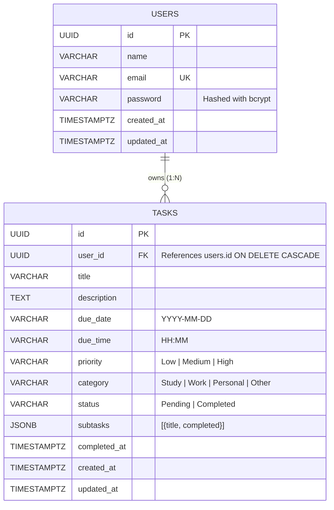

# ⚡ TaskMaster - Modern Full-Stack Task Management Web Application

> A clean, responsive, production-ready Full-Stack Task Manager web application built with HTML5, CSS3, Vanilla JavaScript, Node.js, Express.js, and **Supabase PostgreSQL** with JWT authentication. Designed for real-world productivity and suitable as a college mini-project / semester project.

---

## 📌 Project Overview

**TaskMaster** is a complete multi-user productivity platform that enables individuals to manage their tasks, deadlines, priorities, and subtasks efficiently. It adheres to the MVC (Model-View-Controller) architecture, follows strict RESTful API design principles, and features an interface with light/dark theme support, instant filtering, and responsive mobile-ready layout.

---

## 🛠️ Technology Stack

| Layer | Technologies Used |
| :--- | :--- |
| **Frontend** | HTML5 Semantic markup, CSS3 (Custom design system, CSS Grid/Flexbox, CSS Variables), Vanilla JavaScript (ES6+ Modules, Fetch API, DOM manipulation) |
| **Backend** | Node.js (v18+), Express.js (REST API framework) |
| **Database** | **Supabase PostgreSQL** (Relational tables, Foreign Key constraints, JSONB subtasks, Indexes, Triggers, RLS) |
| **Authentication** | JSON Web Tokens (`jsonwebtoken`) & password hashing with `bcryptjs` (salt rounds: 10) |
| **Security & Middleware** | CORS, JWT Bearer Token verification, Route Protection, Centralized Error Handling, Supabase Connection Health Watcher |

---

## 🏗️ System Architecture & Workflow



---

## 🗄️ Database Design (Entity-Relationship Diagram)



---

## 📂 Project Directory Structure

```text
task-manager/
├── frontend/
│   ├── index.html          # Public landing page & interactive API documentation
│   ├── login.html          # User login page with demo account autofill
│   ├── register.html       # User registration page with client-side validation
│   ├── dashboard.html      # Flagship productivity dashboard with sidebar & metrics
│   ├── css/
│   │   └── style.css       # Full design system (Light/Dark mode, responsive grid, animations)
│   └── js/
│       ├── api.js          # Centralized Fetch wrapper, Toast notifications, Theme toggle
│       ├── auth.js         # Authentication state, login, register, logout handlers
│       ├── dashboard.js    # Metric calculation, greetings, progress bar animation
│       └── tasks.js        # Full Task CRUD, search/filtering, subtasks & modals
│
├── backend/
│   ├── server.js           # Express app entry point, static file server, health check
│   ├── config/
│   │   ├── db.js           # Bridge configuration module
│   │   └── supabase.js     # Supabase PostgreSQL client configuration & health watcher
│   ├── models/
│   │   ├── User.js         # Supabase PostgreSQL User table definition
│   │   └── Task.js         # Supabase PostgreSQL Task table definition
│   ├── routes/
│   │   ├── authRoutes.js   # Authentication route definitions
│   │   └── taskRoutes.js   # Task route definitions (all protected)
│   ├── controllers/
│   │   ├── authController.js # Register, login, and user profile handlers (Supabase queries)
│   │   └── taskController.js # Tasks CRUD, toggle complete, and summary statistics
│   ├── middleware/
│   │   ├── authMiddleware.js # JWT Bearer token verification
│   │   ├── dbCheckMiddleware.js # Database readiness validator
│   │   └── errorMiddleware.js# 404 handler and PostgreSQL/JWT global error formatter
│   └── utils/
│       ├── generateToken.js  # JWT sign utility function
│       └── mockStore.js      # Resilient in-memory fallback store
│
├── supabase_schema.sql     # Complete PostgreSQL DDL schema & sample seeds for Supabase
├── .env                    # Active environment variables (git-ignored)
├── .env.example            # Environment configuration template
├── package.json            # Project dependencies and npm scripts
└── README.md               # Comprehensive documentation and viva guide
```

---

## 🚀 Quick Setup & Installation Guide

### Prerequisites
- [Node.js](https://nodejs.org/) (Version 18 or higher installed)
- A free account on [Supabase](https://supabase.com)

---

### Step 1: Install Dependencies
Open your terminal in the project directory and run:
```bash
npm install
```

---

### Step 2: Supabase Database Setup (Takes 2 Minutes)
1. Go to [Supabase](https://supabase.com) and create a free project.
2. In your Supabase project dashboard, open the **SQL Editor** tab on the left sidebar.
3. Open `supabase_schema.sql` from this project, copy all contents, paste into the SQL Editor, and click **Run**.
4. This automatically creates:
   - `public.users` table with UUID keys & unique indexes
   - `public.tasks` table with foreign key cascades, JSONB subtasks, and indexes
   - Automatic `updated_at` triggers
   - Row Level Security (RLS) policies

---

### Step 3: Configure Environment Variables
Copy `.env.example` to `.env`:
```bash
# Windows PowerShell
copy .env.example .env
```

Open `.env` and set your Supabase credentials:
```env
PORT=5000
NODE_ENV=development

# Supabase Credentials (from Supabase Project Settings -> API)
SUPABASE_URL=https://your-project-id.supabase.co
SUPABASE_KEY=your-supabase-service-role-or-anon-key

# JWT Settings
JWT_SECRET=super_secret_jwt_key_task_manager_project_2026_xyz
JWT_EXPIRE=30d
```

> **Note:** If `SUPABASE_URL` is omitted or left as placeholder, the server automatically starts in a **resilient in-memory fallback mode** with demo data so you can test immediately!

---

### Step 4: Run the Application

#### Development Mode (Auto-reloads on file edits):
```bash
npm run dev
```

#### Production Mode:
```bash
npm start
```

Once running, access the web application in your browser:
- **Application URL**: `http://localhost:5000`
- **Dashboard Direct**: `http://localhost:5000/dashboard.html`
- **API Health Check**: `http://localhost:5000/api/health`

---

## 📡 REST API Documentation

All protected endpoints require an `Authorization` header containing the user's JWT token:
```http
Authorization: Bearer <your_jwt_token>
```

### 1. Authentication Endpoints

| Method | Endpoint | Access | Description | Request Body |
| :--- | :--- | :--- | :--- | :--- |
| `POST` | `/api/auth/register` | Public | Register new user account | `{ "name": "...", "email": "...", "password": "..." }` |
| `POST` | `/api/auth/login` | Public | Sign in and receive JWT token | `{ "email": "...", "password": "..." }` |
| `GET` | `/api/auth/me` | Private | Retrieve current user profile | Header with Bearer Token |

#### Sample Registration Request:
```json
POST /api/auth/register
Content-Type: application/json

{
  "name": "Jane Doe",
  "email": "jane@example.com",
  "password": "password123"
}
```

---

### 2. Task Management Endpoints

| Method | Endpoint | Access | Query Parameters | Description |
| :--- | :--- | :--- | :--- | :--- |
| `GET` | `/api/tasks` | Private | `search`, `status`, `priority`, `category`, `dateFilter`, `sort` | Retrieve user tasks with dynamic search/filters |
| `POST` | `/api/tasks` | Private | None | Create a new task |
| `GET` | `/api/tasks/:id` | Private | None | Get specific task details |
| `PUT` | `/api/tasks/:id` | Private | None | Update task fields and subtasks |
| `PATCH` | `/api/tasks/:id/complete`| Private | None | Toggle Pending ↔ Completed status |
| `DELETE`| `/api/tasks/:id` | Private | None | Delete a task |
| `GET` | `/api/tasks/stats/summary`| Private | None | Retrieve user summary metrics & counts |

---

## 🌟 Key Application Features

1. **User Authentication & Authorization**:
   - Secure registration, login, and session persistence in `localStorage`.
   - Users can strictly access, edit, and delete only their own tasks.
2. **Dashboard Analytics**:
   - Dynamic counter cards for Total, Pending, Completed, Overdue, and High-Priority tasks.
   - Animated visual progress bar displaying task completion percentage.
3. **Filtering, Searching & Sorting**:
   - Live debounce search by title or description.
   - Filtering by status, priority, category (Study, Work, Personal, Other), and due dates (Today, This Week, Overdue).
   - Multi-option sorting (Newest, Oldest, Due Date soonest/latest, Priority High-to-Low).
4. **Subtasks & Checklist System**:
   - Tasks support granular subtasks with interactive checkboxes that update completion percentage in real time.
5. **Modern UI & Aesthetic Polish**:
   - Dark mode / Light mode toggle with instant persistence.
   - Custom Toast notifications for all network events.
   - Responsive design for mobile, tablet, and desktop viewports.
   - Delete confirmation modal to avoid accidental data loss.
   - Overdue badges with visual alerts.

---

## ❓ College Mini-Project Viva Q&A Guide

#### Q1: Why did you use JWT instead of standard server sessions?
> **Answer:** JSON Web Tokens (JWT) are stateless. The server does not need to store session IDs in memory or a session table; all essential authentication data and user claims are digitally signed inside the token. This makes the REST API scalable and decoupled from the frontend.

#### Q2: How is password security guaranteed in this application?
> **Answer:** Passwords are never saved in plain text. We utilize `bcryptjs` with 10 salt rounds before persisting user records to Supabase PostgreSQL. Even if database records are exposed, passwords cannot be reversed. Password comparison is handled securely via `bcrypt.compare()`.

#### Q3: Why did you migrate from MongoDB to Supabase PostgreSQL?
> **Answer:** PostgreSQL provides strong ACID compliance, relational integrity with foreign keys (`ON DELETE CASCADE`), structured schemas, and indexing. Supabase provides an enterprise-ready managed PostgreSQL environment with instantaneous REST APIs, real-time features, and secure Row Level Security (RLS) policies.

#### Q4: How are subtasks stored in PostgreSQL without creating an overly complex join?
> **Answer:** PostgreSQL supports native `JSONB` data types. We store task subtasks as a `JSONB` array within `public.tasks`. This allows atomic updates, schema flexibility for nested checklists, and high performance without needing multi-table joins.

#### Q5: How do you enforce data isolation between users?
> **Answer:** Every task record has a `user_id` foreign key referencing the `users.id` primary key. In the backend task controller, queries are filtered by `req.user.id` extracted from the verified JWT bearer token. In update/delete operations, the backend validates user ownership before performing mutations.

---

## 🔧 Common Errors & Troubleshooting

| Error | Root Cause | Solution |
| :--- | :--- | :--- |
| `Offline / Memory Mode` banner | Supabase credentials not set in `.env` | Set `SUPABASE_URL` and `SUPABASE_KEY` in `.env` from your Supabase dashboard. |
| `relation "public.users" does not exist` | SQL schema has not been executed | Copy `supabase_schema.sql` and run it in your Supabase SQL Editor. |
| `EADDRINUSE: address already in use :::5000` | Port 5000 is occupied by another process | Change `PORT=5001` in your `.env` file or terminate the existing process. |
| `jwt must be provided` or `401 Unauthorized` | Token is missing or expired | Log in again through `/login.html` to generate a fresh token. |

---

## 📜 License
This project is open-source and created for educational and mini-project purposes under the [MIT License](LICENSE).
